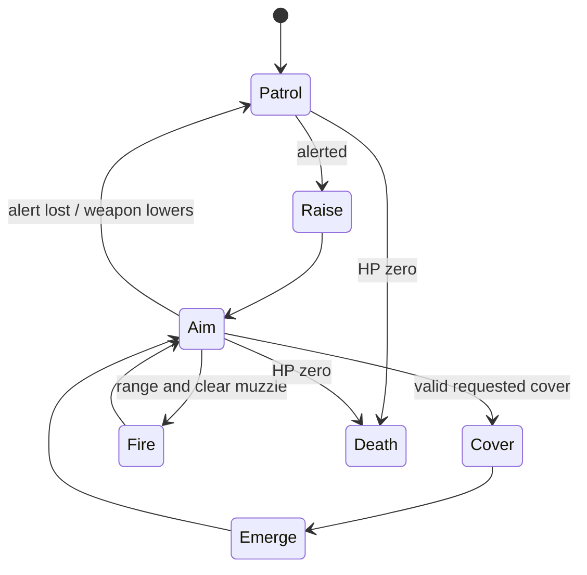

# Royal Guard architecture

## Observations and state

SenseThreat combines range, field of view and collision visibility with a six-second target memory, recent HP loss and a projected line from the player’s last magic shot. That projection flags a threat near the guard, even when a shot has yet to deal damage. Target visibility uses Clear; LateUpdate rechecks range and muzzle visibility before spawning the bolt. SeekCoverOnDetection is disabled in the source prefab, so merely seeing the player does not request cover by default.

## Decision and recovery

Patrol alternates waypoint goals with turn and walk states. WeaponRaise leads into aiming or a cover request. CoverSequence manages movement to hide, the take-cover animation, cover idle, and emergence toward the peek position. Fire is animation-timed and uses a cooldown. Losing alert eventually lowers the weapon and resumes patrol. Health loss can request cover and trigger hit reaction. Death stops navigation and releases the reservation.

## Movement or spatial action selection

ChooseCover scans a registry of active GuardCoverPoint components. TryPlan samples a hide point beyond the collider from the threat, requires that the same barricade occlude a crouched line, and tests up to six lateral peek candidates. The valid peek with the shortest squared hide-to-peek distance wins inside each plan. The outer cost is squared guard-to-hide distance plus 0.35 times squared hide-to-peek distance. Go and PathInsideLeash require a complete NavMesh route with corners bounded by the home leash. TryAimPosition checks an ordered fan around a proposed tactical offset. This is local candidate ranking and constraint filtering layered on Unity NavMesh.

## Source landmarks

RoyalGuardAI.SenseThreat, Patrol, ChooseCover, CoverSequence, AimOrAdvance, TryAimPosition, Go, PathInsideLeash, LateUpdate and GuardCoverPoint.TryPlan, Shelters, Reserve, Release.

The diagram summarizes the principal flows; damage/death can preempt applicable states and some short-lived branches are omitted.

