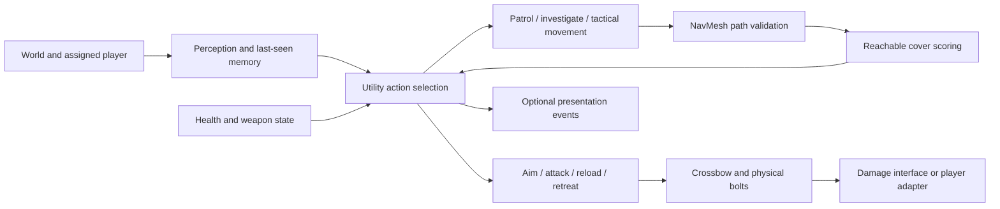

<div align="center">

# THE JADE SEAL

**A Fantasy 3D Shooting Game Powered by Autonomous AI Agents**

An academic Unity project combining a temple-and-mountain fantasy world with individually developed intelligent enemies.


**SE3032 Graphics & Visualization · SE3062 Intelligent Systems · Four-member team · SLIIT**

[Get started](#installation-and-setup) · [Enemy AI](#enemy-ai-system) · [Validation](#testing-and-validation) · [Team workflow](#git-branching-and-team-collaboration) · [Attribution](#licenses-and-asset-attribution)

</div>


*Existing approved environment comparison, not a combat screenshot. See [visual approvals](Documentation/Handoff/VISUAL_APPROVAL.md).*

> **Repository snapshot — 21 October 2026:** `main` includes the complete environment through PR #1 (`13d3406`, incorporating `3f4a16e`). The Royal Guard implementation is on `feature/royal-guard-ai` (`c0fa941`) and is **not integrated into main**. The other three autonomous agents and the complete player combat loop are not verified as implemented. The AI badges describe the Royal Guard branch; they do not imply four integrated enemies.

## About the game

THE JADE SEAL is being developed as a Unity 3D fantasy shooting game. Its existing world connects a forest approach, the **Crimson Clan Courtyard**, **Celestial Mountain Pass**, and **Celestial Jade Sanctuary**, with a Jade Seal landmark and authored encounter, spawn and objective anchors.

The intended player experience is to traverse this world and confront autonomous enemies in ranged combat. The existing forest-to-Jade-Seal traversal route establishes the spatial journey; a finalized narrative, playable mission sequence, inventory, score system, win/loss conditions and boss encounters are **planned or not verified**. Objective and boss markers currently describe placement; they do not execute gameplay.

The current `main` is an environment foundation that can be opened and inspected in Unity. The Royal Guard branch adds an independently testable enemy module. Neither should be presented as a finished four-enemy shooting game.

## Project objectives

- Build an interactive 3D shooting experience within a cohesive fantasy environment.
- Give each of four team members responsibility for a distinct autonomous agent.
- Demonstrate perception, tactical decision-making and validated navigation beyond basic patrol-and-shoot behavior.
- Combine environment geometry, materials, lighting and visualization from **SE3032** with explainable intelligent systems from **SE3062**.
- Maintain reproducible setup, clear individual ownership and evidence that can be reviewed during the VIVA.

## Core features

| Area | Verified implementation | Availability |
|---|---|---|
| World design | Four connected zones, terrain, vegetation, temple/courtyard architecture and layout metadata | `main` and `feature/world-environment` |
| Collision and navigation | Collision geometry, saved NavMesh data, a NavMeshSurface and modifier volumes | Environment |
| Lighting and rendering | Built-in Render Pipeline, three baked lightmap sets, 194 probes and reflection data | Environment |
| Tactical enemy AI | Seven-state Utility AI, perception/memory, reachable cover selection and defensive retreat | Royal Guard branch |
| Enemy ranged combat | Crossbow bolts, collision damage, cooldown, magazine reload and health/death events | Royal Guard module; scene integration pending |
| Player movement and shooting | Input-action configuration exists; the retained traversal tester is not a shipping player controller | Gameplay implementation not verified |
| Complete encounter/progression loop | No verified four-agent integration, objective completion or win/loss logic | Planned |

## Enemy AI system

The team has **four members**, each responsible for a distinct autonomous agent. Only the Royal Guard has an inspected gameplay implementation. Placeholder agent labels below identify unconfirmed responsibilities, not invented enemy names.

| Enemy / agent slot | AI technique | Combat role | Responsible member | Current status |
|---|---|---|---|---|
| **Royal Guard** | Utility AI, weighted cover evaluation, Unity NavMesh | Heavily armored ranged crossbow enemy | Royal Guard contributor — name to confirm | Implemented and module-tested on `feature/royal-guard-ai`; world integration pending |
| Agent 2 — name to confirm | Not verified | To be confirmed | Member name to confirm | Planned; implementation not found |
| Agent 3 — name to confirm | Not verified | To be confirmed | Member name to confirm | Planned; implementation not found |
| Agent 4 — name to confirm | Not verified | To be confirmed | Member name to confirm | Planned; implementation not found |

The existing `feature/Models` branch contains `player.fbx`, `guard.fbx`, `bamboo.fbx` and `MA.fbx`. These filenames and model commits do not establish AI behavior, agent identities, rig/animation readiness or asset clearance. Do not infer the other agents' abilities from them.

### Royal Guard

The Royal Guard is designed as a durable, tactical ranged opponent. Its current defaults are **180 HP**, **15 damage per bolt**, **38 m/s bolt speed**, a **0.75-second firing interval**, **five-round magazine** and **two-second reload**. Higher health and faster attacks are design goals relative to standard enemies; no other implemented enemy baseline is available for a measured comparison. Armor is a character concept; no separate armor damage-reduction system is claimed.

Its module implements:

- Distance, field-of-view and obstacle-linecast detection, with a six-second last-known-position memory.
- **Patrol, Investigate, SeekCover, Reposition, Attack, Reload and Retreat** decisions.
- Complete-path NavMesh validation, periodic replanning, movement-failure handling and cover reservations.
- Cover scoring using travel distance, path length, authored cover quality, exposure and a reachable firing opportunity.
- Muzzle obstruction checks, physical projectile damage and independent firing/reload timing.
- Low-health retreat, delayed capped recovery, damage/death events and optional presentation hooks.
- Utility hysteresis, minimum state duration, tactical movement timeouts and Inspector/Gizmo diagnostics.

The prefab uses an explicitly labelled capsule and primitive crossbow placeholder. No finished character animation or audio is supplied. Real player references, cover/waypoints, collision layers and the damage-adapter connection must be assigned by the integrator.

**Royal Guard branch documentation:** [README](https://github.com/HiruniPramodini/The-Jade-Seal/blob/feature/royal-guard-ai/Assets/RoyalGuardAI/README.md) · [Setup](https://github.com/HiruniPramodini/The-Jade-Seal/blob/feature/royal-guard-ai/Assets/RoyalGuardAI/SETUP_GUIDE.md) · [Architecture](https://github.com/HiruniPramodini/The-Jade-Seal/blob/feature/royal-guard-ai/Assets/RoyalGuardAI/AI_ARCHITECTURE.md) · [Validation](https://github.com/HiruniPramodini/The-Jade-Seal/blob/feature/royal-guard-ai/Assets/RoyalGuardAI/VALIDATION_REPORT.md) · [Test plan](https://github.com/HiruniPramodini/The-Jade-Seal/blob/feature/royal-guard-ai/Assets/RoyalGuardAI/TEST_PLAN.md) · [VIVA guide](https://github.com/HiruniPramodini/The-Jade-Seal/blob/feature/royal-guard-ai/Assets/RoyalGuardAI/VIVA_GUIDE.md).

## AI architecture

The following diagram describes the implemented **Royal Guard module**, not a completed shared framework for all four agents.



**Perception** supplies only currently visible or remembered information. **Decision-making** scores feasible actions and retains a valid current action unless a challenger exceeds its hysteresis margin; emergencies can interrupt the minimum dwell time. **Navigation** checks sampled destinations, agent type, area mask and complete paths before movement. **Execution** separates weapon, health and presentation concerns from tactical policy.

For cover, the normalized score is:

```text
score = (wd × proximity + wp × pathEfficiency + wq × quality
         + we × protection + wf × firingOpportunity) / sum(weights)
```

The default weights are **1, 1.5, 2, 3 and 2**, respectively. Exposure is estimated with three line probes; unsuitable or unreachable points are rejected. Reservations reduce contention between guards. This combines context-sensitive action selection with informed tactical evaluation rather than simply following patrol points or chasing the player's current position.

Unity's NavMesh provides native graph-based pathfinding and local avoidance. The project does not claim a custom A* implementation, machine learning or learned utility weights. Cover quality is authored; protection and firing opportunities are evaluated against observed information. See the architecture document for formulas, complexity and limitations.

## Graphics & Visualization

The retained environment combines authored terrain and layout work with attributed architectural and vegetation inputs. Scene content includes courtyard paving, temple structures, mountain routes, sanctuary geometry, bamboo, shrubs, ferns, rocks and project-authored pine geometry using credited material maps.

Verified approaches include **Built-in rendering**, baked lighting, light/reflection probe data, material/texture adaptation, mesh/UV2 copies, collision proxies and vegetation LOD handling. The scene's navigation and layout metadata support future encounters while preserving the approved world. The [courtyard](Documentation/VisualReview/02_Courtyard.png), [mountain](Documentation/VisualReview/03_Mountain.png) and [sanctuary](Documentation/VisualReview/04_Sanctuary.png) images record the approved clearance/rebake comparisons.

Models, animations and gameplay presentation are separate integration tasks. Royal Guard events provide attachment points for an Animator/audio bridge, but a finished animated combat presentation is not verified. Do not convert the project to URP/HDRP or regenerate the authored world as a routine setup step.

## Technology stack

| Technology | Verified version / purpose |
|---|---|
| Unity Editor | **6000.3.25f1**, revision `e1dba0a9aba4` |
| Rendering | Built-in Render Pipeline |
| C# | World metadata, vegetation behavior, editor tooling and Royal Guard gameplay |
| AI Navigation | `com.unity.ai.navigation` **2.0.16** |
| Input System | `com.unity.inputsystem` **1.20.0**; supplied action configuration is not proof of a complete controller |
| Git / GitHub | Branch-based collaboration and pull-request review; repository is private |
| Git LFS | Scenes, `.asset` data, terrain layers, designated image formats and FBX files, as declared in `.gitattributes` |
| Windows Build Support | Required for reproducing the documented Windows build |

Versions are pinned in [ProjectVersion.txt](ProjectSettings/ProjectVersion.txt), [manifest.json](Packages/manifest.json) and [packages-lock.json](Packages/packages-lock.json). No particular C# language version, external AI framework or additional rendering package is asserted.

## Project structure

```text
The-Jade-Seal/
├── Assets/
│   ├── JadeSeal/
│   │   ├── Scenes/JadeSealFantasy.unity   # Main environment scene
│   │   ├── Scripts/                     # World markers
│   │   ├── Phase6/                      # Zone layout metadata
│   │   └── Phase7/                      # Navigation data / route metadata
│   ├── JadeSealDistribution/            # Cleared world assets and vegetation
│   ├── Editor/                         # Retained authored geometry source
│   ├── asian-building/                 # Attributed architecture inputs
│   ├── chinese-temple/
│   ├── InputSystem_Actions.inputactions
│   └── RoyalGuardAI/                    # ROYAL GUARD BRANCH ONLY
│       ├── Scripts/                     # Modular gameplay implementation
│       ├── Editor/                      # Diagnostics and validation runners
│       ├── Prefabs/                     # Placeholder guard and bolt
│       ├── Evidence/                    # Actual assertion results
│       └── *.md                        # Setup, architecture, tests and VIVA
├── Packages/                           # Manifest and package lock
├── ProjectSettings/
├── Documentation/                      # Handoff, validation, clearance, notices
├── TEAMMATE_SETUP.md
├── THIRD_PARTY_ASSETS.md
└── README.md
```

Other agents' implementation directories are not yet verified. Unity creates `Library`, `Temp` and `Logs` locally; they are not source payloads to share or commit.

## Installation and setup

### 1. Prepare Windows

Install **Unity Hub**, **Git for Windows** and **Git LFS**. In Unity Hub, install **Unity 6000.3.25f1** with **Windows Build Support**. Obtain authorized access to this private GitHub repository and authenticate Git using your normal GitHub credentials/credential manager. Do not place access tokens in commands or project files.

### 2. Clone the verified environment

In PowerShell, from the parent directory where you want the project:

```powershell
git lfs install
git clone --branch feature/world-environment https://github.com/HiruniPramodini/The-Jade-Seal.git
Set-Location The-Jade-Seal
git lfs pull
git status --short
```

This deliberately selects the complete environment branch. The inspected `main` already contains that environment through PR #1; the Royal Guard remains on its own branch. A successful clone requires both repository access and access to its LFS objects. An empty status output means there are no working-tree changes.

### 3. Open the scene

In Unity Hub, choose **Add project from disk**, select the cloned directory containing `Assets`, `Packages` and `ProjectSettings`, and open it with the exact editor version. Allow package resolution and asset import to finish. Open:

```text
Assets/JadeSeal/Scenes/JadeSealFantasy.unity
```

Keep the existing baked scene folders, terrain, materials, reflection data and `.meta` files together. Resolve Console compilation errors before entering Play Mode. The environment is not a ready-made combat demo: there is no verified shipping player controller or automatic enemy encounter setup on `main`.

For a future Windows build, add this scene to a **Build Profile**; the retained `EditorBuildSettings` has an empty scene list. A previously successful build report does not supply a downloadable executable in this checkout. See [TEAMMATE_SETUP.md](TEAMMATE_SETUP.md) for retained-world constraints.

### 4. Inspect or integrate the Royal Guard

With a clean checkout, inspect the agent on a separate local branch:

```powershell
git fetch origin
git switch --create review/royal-guard --track origin/feature/royal-guard-ai
git lfs pull
```

Use a new branch name if `review/royal-guard` already exists. This switches to the agent's environment-based snapshot; it does not merge it into `main`. Follow the branch's `Assets/RoyalGuardAI/SETUP_GUIDE.md`: place the prefab on the NavMesh, assign the player and patrol points, author hide/peek cover points, configure world-only obstacle layers, and connect `RoyalGuardDamageAdapter` to actual player health. Its event has no gameplay effect until connected. Preserve the placeholder's Eyes/Muzzle references when attaching a licensed final model.

### Troubleshooting

| Symptom | What to check |
|---|---|
| Missing models or tiny text files instead of assets | Run `git lfs install`, `git lfs pull` and `git lfs ls-files`; check private-repository permissions and LFS availability. Never replace missing assets with unrelated local packs. |
| Pink materials | Confirm exact Unity version, Built-in rendering, completed imports and hydrated textures/shaders. Inspect the failing material's Console message before changing shader assignments. |
| Script errors | Check the first Console compilation error, exact package versions and branch contents. Do not copy another project's Library or install arbitrary package versions to bypass it. |
| Agent does not move or shoot | On the Royal Guard branch, verify NavMesh placement/type, references, masks, reachable cover, muzzle position and player-health hookup. Consult its setup guide. |
| Scene is absent from build | Add `JadeSealFantasy.unity` to the chosen Build Profile. |

## How to play

**Final gameplay controls are being finalized.** No production player controller or complete shooting loop was found in the inspected gameplay branches. The template input configuration includes action names such as Move, Look and Attack, but bindings alone do not implement those mechanics.

| Context | Verified input | Scope |
|---|---|---|
| Final player movement / aim / fire | Not finalized or verified | Do not treat template bindings as working gameplay |
| Temporary Phase7 manual traversal tester | WASD; mouse look after left-click capture | Only when that diagnostic tester is explicitly instantiated; not the saved game's player controller |
| Temporary tester cursor / finish | Escape releases cursor; F10 finishes the test | Diagnostic controls only; left-click is not shooting in this tester |

For now, inspect the environment in Unity and use the agent's documented integration/test setup for combat evaluation. A mission loop, objective completion, progression and win/loss conditions remain to be implemented or verified.

## Git branching and team collaboration

| Branch | Inspected purpose and state |
|---|---|
| `main` | Shared integration branch; includes environment via PR #1 at `13d3406` |
| `feature/world-environment` | Complete approved world handover at `3f4a16e`; all 22 environment commits after the initial project-title commit are preserved |
| `feature/royal-guard-ai` | Royal Guard implementation at `c0fa941`; ten additional commits based on the world branch; not merged into `main` |
| `feature/player-combat` | Existing branch; inspected tip contains only the initial README, no player implementation |
| `feature/gameplay-ui` | Existing branch; inspected tip contains only the initial README, no UI implementation |
| `feature/enemy-ai-agents` | Existing branch; inspected tip contains only the initial README, no agent implementation |
| `feature/Models` | Existing model-only branch; separate from integrated gameplay |
| `docs/main-project-readme` | Documentation-only proposal based on current `origin/main` |

Branches can be ahead of, behind, or diverged from `main`; check their actual contents before assuming features are integrated. Historical handoff reports record their own approval dates and may describe push/merge steps that subsequently occurred. This README's snapshot reflects the inspected Git ancestry.

Start your own work from an updated, clean base:

```powershell
git status --short
git fetch origin
git switch --create feature/your-task origin/main
```

After making and reviewing a focused change, stage **explicit paths**. For a README-only change:

```powershell
git diff -- README.md
git add -- README.md
git diff --cached --check
git commit -m "docs: clarify project setup"
git push -u origin feature/your-task
```

On GitHub, open **Pull requests → New pull request**, select **base: main** and your feature branch as **compare**, then document scope, validation and remaining limitations. Request teammate review before merging; do not push directly to `main` or rewrite shared history.

For Unity collaboration:

- Commit new/moved assets together with their `.meta` files. Move assets through Unity so GUID-based scene/prefab references survive.
- Agree on scene ownership before editing. Prefer separate prefabs and test scenes for each agent; coordinate the final environment-scene integration to avoid simultaneous YAML edits.
- Review `git status` and staged paths. Keep caches, build outputs, unrelated source archives and unapproved assets out of commits.
- Install LFS on every machine; run `git lfs pull` after switching branches. Preserve existing `.gitattributes`; never commit an LFS pointer as a replacement for missing local content or remove tracking rules to work around download failures.
- Do not rerun historical environment/geometry generators as a setup step. Preserve the reviewed world and its attribution evidence.

## Testing and validation

These are **recorded results from their stated snapshots**, not a claim that this README update reran Unity or tested a finished game.

| Scope | Recorded result | Evidence / limit |
|---|---|---|
| Cleared environment Windows Development build | Succeeded; zero BuildReport errors/warnings | [Build.json](Documentation/Validation/Build.json); prior build, not a new release build |
| Environment navigation / references | 274 checked segments; zero navigation failures, missing scripts/materials or broken references in that report | [Validation.json](Documentation/Validation/Validation.json) |
| Physical world traversal | 16 routes passed | [STANDALONE_ROUTES.csv](Documentation/Validation/STANDALONE_ROUTES.csv); movement coverage, not combat/progression tests |
| Royal Guard deterministic editor assertions | 21 passed | Agent branch evidence; custom assertions, not NUnit |
| Royal Guard real-frame Play Mode assertions | 27 passed | Agent branch evidence; synthetic scene with runtime NavMesh, wall and player collider |
| Full four-agent gameplay and real player-health connection | Pending | No integrated-game pass claimed |

The [Royal Guard validation report](https://github.com/HiruniPramodini/The-Jade-Seal/blob/feature/royal-guard-ai/Assets/RoyalGuardAI/VALIDATION_REPORT.md) distinguishes compilation, assertion results and manual work. It records a UnityEditor.Search startup `ArgumentOutOfRangeException` during Play Mode runs; assertions completed, but those runs are not represented as a clean Console.

Pending checks include actual world-scene combat, real player damage adapters, full patrol/investigation routes, dynamic obstacles, sustained multi-agent behavior, animation/audio, balancing and crowd performance. No fresh FPS guarantee, human visual combat approval or four-enemy integration result is claimed. Follow the module test plan and retain observed results/screenshots or video separately from planned cases.

## Team contributions

| Team slot | Individual autonomous-agent responsibility | Member identity |
|---|---|---|
| 1 | Royal Guard — modular Utility AI, tactical crossbow combat, documentation and module validation | Name to confirm |
| 2 | Distinct agent — name/technique to confirm | Name to confirm |
| 3 | Distinct agent — name/technique to confirm | Name to confirm |
| 4 | Distinct agent — name/technique to confirm | Name to confirm |

The environment Git history credits **Hiruni Pramodini**. This does not establish the remaining team roster or map every shared environment task to an individual agent slot. Add verified names, student IDs and specific contributions when the team confirms them. The Royal Guard contributor's work is traceable through its separate implementation commits and evidence; other agents must be credited from their actual future work.

## Current development status

| Area | Status | Meaning |
|---|---|---|
| Environment | **Complete** | Approved world handover and recorded environment validation; already on `main` |
| Player mechanics | **Not Verified** | Input configuration exists; production movement, shooting and health loop not found |
| Royal Guard AI | **In Progress** | Core code and module checks complete; final model and world/player integration pending |
| Other enemy agents | **Planned** | Three distinct agent implementations not found in inspected branches |
| Gameplay integration | **In Progress** | World foundation and agent module exist separately; complete playable loop remains pending |
| Testing | **In Progress** | Environment and Royal Guard evidence exists; integrated/manual gameplay coverage remains pending |

## Known limitations and future improvements

- Integrate and document the other three agents without overwriting individual ownership.
- Implement/verify player controls, weapon damage, health, objectives and win/loss behavior.
- Connect the Royal Guard's player-health adapter and authored cover/patrol references in a reviewed scene.
- Replace primitive visuals with licensed models; add animation, hit/death reactions and audio through presentation hooks.
- Tune tactical weights, recovery and attack cadence through observed gameplay; the current utility policy uses authored rules, not learning.
- Evaluate large cover lists and crowds: cover path queries and corner-array allocations need profiling before scaling.
- Test blocked paths, moving players, respawn, multi-agent reservations and long sessions in the actual world. A guard can safely stop when no reachable escape exists.
- Investigate the recorded Unity search-indexer exception and complete human visual/playability review.

## Licenses and asset attribution

This repository is **private**, confirmed during this README review. No project-wide open-source license has been assigned. The documented owner permission covers private sharing of included original contributions with authorized teammates; it is not a public-publication grant or a transfer of third-party rights.

The authoritative [THIRD_PARTY_ASSETS.md](THIRD_PARTY_ASSETS.md) retains creator/source/license links and modification disclosures. Credited inputs include **riysstech** (bamboo), **LOLIPOP / @lolipop_1707** (bush pack), **Pikas** (Asian Building), **Thomas.Osterhammel / Thost** (Chinese Temple), and Poly Haven contributors **Kless Gyzen, Rico Cilliers, Rob Tuytel and Dario Barresi** for the listed rock, fern and material-map inputs. Preserve the full register rather than relying on this abbreviated acknowledgment.

CC BY inputs retain their attribution, source/license and modification-notice requirements. CC0 inputs keep their provenance credits; original project geometry/code is not automatically CC0. Private-team permissions do not add restrictions to upstream CC BY/CC0 inputs or clear excluded packs. Do not label the entire project MIT or claim ownership of imported assets.

The supplied Unity input-action configuration has its [original template notice](Documentation/UnityTemplate/LICENSE.md) and [Unity Companion License terms](Documentation/UnityTemplate/UNITY_COMPANION_LICENSE_v1.4.txt). Preserve [package notices](Documentation/PackageNotices/PACKAGE_NOTICE_REGISTER.csv), [head-geometry attribution](Documentation/FinalHeads/ATTRIBUTION_ADDENDUM.md), [temple attribution](Documentation/Temple/ATTRIBUTION_ADDENDUM.md) and the [portable evidence index](Documentation/Clearance/PORTABLE_EVIDENCE_INDEX.md). Some historical addenda reference retained local audit layouts; the index explains their scope. Model-only branch assets require their own verified provenance before integration.

## Acknowledgments

Developed for **SLIIT**, bringing together **SE3032 Graphics & Visualization** and **SE3062 Intelligent Systems**. Thanks to the four-member project team and the asset creators credited in the retained attribution register. Upstream creators and tool publishers are not implied to endorse the project.
